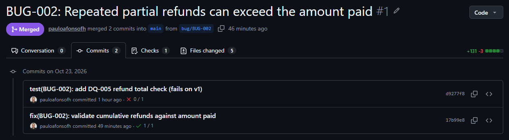

# E-commerce data-quality lab

[](https://github.com/pauloafonsofh/ecommerce-data-quality-lab/actions/workflows/ci.yml)

A small PostgreSQL online store with **intentionally seeded silent defects**, and a SQL test suite that finds them.
Each defect has a written report and a pull request where CI goes from red to green.
The defects reproduce patterns I've found while testing production systems.

## Defects found

| ID | Defect | Business impact | Severity | Report | Pull request |
|---|---|---|---|---|---|
| BUG-002 | Repeated partial refunds can exceed the amount paid | A customer gets back more money than they paid | Critical | [BUG-002](docs/bugs/BUG-002.md) | [#1 red → green](https://github.com/pauloafonsofh/ecommerce-data-quality-lab/pull/1) |
| BUG-005 | Daily revenue report double-counts orders with several items or payments | The revenue report overstates sales | Major | [BUG-005](docs/bugs/BUG-005.md) | [#2 red → green](https://github.com/pauloafonsofh/ecommerce-data-quality-lab/pull/2) |

**Start here:** the [BUG-002 report](docs/bugs/BUG-002.md) and [pull request #1](https://github.com/pauloafonsofh/ecommerce-data-quality-lab/pull/1).
The new check fails on the first commit and passes after the fix.



## What this demonstrates

- **Risk-based test strategy:** business rules first, then one check per rule ([test strategy](docs/test-strategy.md)).
- **Data validation with SQL** on the full data set, not on a sample.
- **Independent test oracles:** a second calculation and a small data set computed by hand.
- **Defect reports** with impact in rows and money, blast radius and data remediation.
- **Regression checks in CI** (GitHub Actions) on every pull request and every push to `main`.
- **Tests for the tests:** deliberate mutations prove that each check can fail ([mutations](docs/mutations.md)).

## How it works

| Folder | What it contains |
|---|---|
| `db/` | The system under test: tables, store functions, revenue report, seed data |
| `scenarios/` | Steps that call the functions and record the status each one returns |
| `checks/` | One SQL query per business rule. It returns the rows that break the rule. Zero rows = PASS |
| `impact/` | Queries that measure each defect in rows and money |
| `run_tests.sh` | Builds a fresh database, loads everything and runs the checks. Exit 0 = PASS, 1 = FAIL, 2 = ERROR |

An SQL error inside a check is reported as ERROR, never as PASS.

Output for BUG-002, before the fix:

```
DQ-000   scenario steps return expected status          1  FAIL
           | S02-04|REFUND_EXCEEDS_PAID|OK
DQ-005   refunds never exceed payment                   1  FAIL
           | PAY-B002|100.00|120.00|20.00

== Impact: BUG-002_impact
 payments_over_refunded | excess_refunded
                      1 |           20.00
```

After the fix:

```
Checks: 8 total, 8 PASS, 0 FAIL, 0 ERROR
```

## Run it

Requirements: PostgreSQL 17 on `127.0.0.1` and Bash (Git Bash on Windows).

```bash
export PGUSER=postgres
export PGPASSWORD=...        # or use a pgpass file
./run_tests.sh
```

The script only connects to `127.0.0.1` and only drops and creates the database `dq_lab`.
`PGPORT` must point to a local PostgreSQL server, not to an SSH tunnel.

## Out of scope

User interface, HTTP APIs, performance and load.

## Roadmap

- **November 2026:** BUG-001, two customers buy the last unit at the same time (race condition), with a concurrency test.
  It will also close the known gap M10 in [mutations](docs/mutations.md).
- **Next:** BUG-003, the same customer registered twice when the tax ID is typed in different formats;
  BUG-004, day and month swapped when importing legacy orders.

## Notes

All data is fictional. Tax IDs are 11-digit numbers that are not valid Brazilian CPFs.

Built with AI assistance; every check, fix and result was reviewed and run by me.
